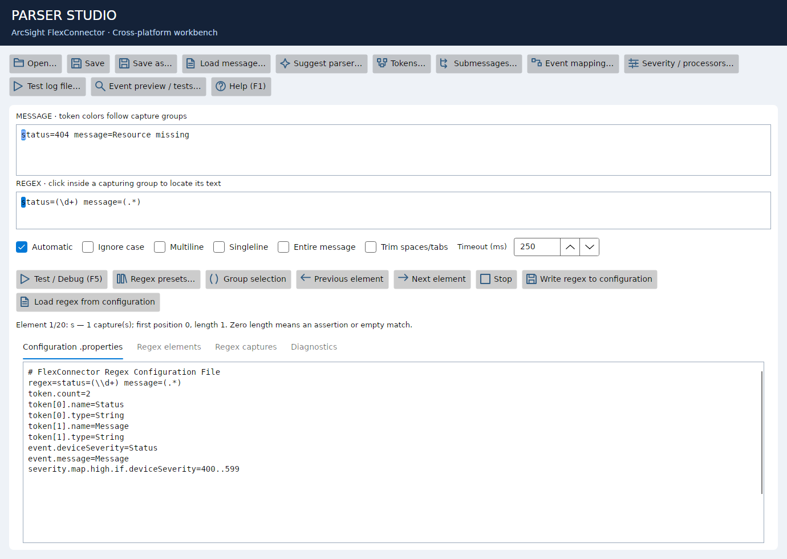
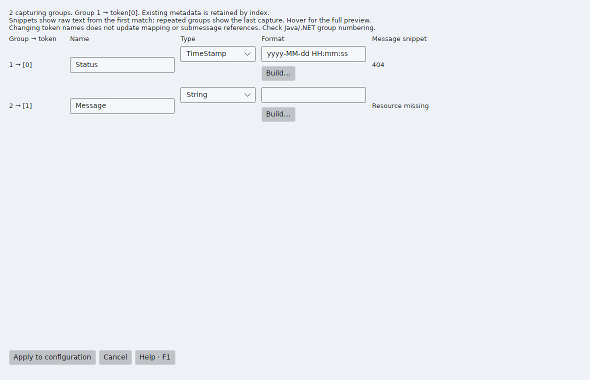

# ArcSight FlexConnector Parser Designer

Version 2.3 adds partial regex previews in the main window and submessage workbench, with highlighted text and element navigation when the complete regex fails.
It also includes offline parser suggestions from logs and event mapping snippets.
See [Parser assistance](docs/PARSER_ASSISTANCE.md) for usage and supported syntax.

A cross-platform desktop workbench for authoring ArcSight FlexConnector regex parsers.
Build a parser from sample logs, inspect capture groups, define tokens and event
mapping, and test submessage variants against an entire log file.

The new application uses **C# / Avalonia / .NET 10**. Its interface and built-in
help, source comments and documentation are English. Current release: **2.3.2**.
The native interface has been tested on Windows and Ubuntu 26.04 under WSLg.
macOS targets are available from source but have not been runtime-tested.
The original WinForms application remains available for Windows.
The publication package contains only the C# solution and its supporting files.
See [release notes](CHANGELOG.md) and the [cross-platform guide](docs/CROSS_PLATFORM.md).



## Features

- Regex preview with capture colors, group-to-message navigation and diagnostics.
- Token generation with captured-text snippets, type selection and a format builder.
- Event mapping editor for tokens, constants and ArcSight expressions.
- Multiple submessages, ordered patterns and default routing.
- Batch log testing with filters, navigation and parser editing.
- Severity rules and extra processor configuration templates.
- Java properties escaping and preservation of unrelated configuration blocks.
- Up to 100 text undo steps, redo and searchable contextual F1 help.
- Compact menus and layouts checked at supported minimum window sizes.

## Requirements

- **.NET 10 SDK** and NuGet access to build the Avalonia edition.
- The prepared Linux x64 / Windows x64 packages include the .NET runtime.
- Linux needs a graphical session and native libraries, including ICU; see the guide.
- Native UI tests require an interactive desktop or Xvfb on Linux.

The cross-platform project uses pinned Avalonia and AvaloniaEdit packages.
`ParserCore` and the original WinForms solution remain package-free.
The PDF guide is a development reference, not a runtime dependency.

## Build and run

In the prepared distribution, use **`app/linux-x64/`** on Ubuntu or
**`app/win-x64/`** on Windows. Keep the entire selected folder together.
Run `ArcSight.ParserDesigner.CrossPlatform` (Linux) or
`ArcSight.ParserDesigner.CrossPlatform.exe` (Windows).
See [setup and packaging](docs/CROSS_PLATFORM.md) and [GitHub publishing](docs/GITHUB.md).

From the repository root:

```powershell
dotnet restore csharp/ArcSight.CrossPlatform.slnx --configfile csharp/ParserDesigner.CrossPlatform/NuGet.Config --packages .nuget-packages
dotnet build csharp/ArcSight.CrossPlatform.slnx -c Release --no-restore
dotnet run --project csharp/ParserDesigner.CrossPlatform -c Release --no-build
```

Use `csharp/ArcSight.CrossPlatform.slnx` in your IDE for the new edition.
The original Windows solution is `csharp/ArcSight.ParserDesigner.slnx`;
its build/run requirements are documented in [distribution details](docs/DISTRIBUTION.md).

## Quick start

1. Use **Open…** to load an example from `examples/`.
2. Paste a log into **Message** and edit the decoded expression in **Regex**.
3. Press **F5**. Click a capturing group to highlight its captured text.
4. Use the toolbar to configure **Tokens**, **Submessages**, **Event mapping** and severity.
5. Use **Test log file…** to test multiple sample events.
6. Apply dialog changes, then **Save / Ctrl+S** to save the configuration.

Press **F1** in an editor for contextual help. See the complete
[User guide](docs/USER_GUIDE.md) for detailed usage.

The token editor includes a read-only sample of each token captured from the
current Message. Hover over a sample for more text and its original position.
Empty and unmatched captures are distinguished; snippets are not written to the parser.



## Verification

```powershell
./scripts/verify-cross-platform.ps1
```

On Ubuntu/macOS use `bash scripts/verify-cross-platform.sh`.
This runs core and Avalonia UI regression executables and checks formatting.
Tests return a nonzero exit code on failure. Screenshots are saved next to the UI
test executable, or to `PARSER_SCREENSHOTS` when set. These are executable tests,
not projects discovered by `dotnet test`. `scripts/verify.ps1` still checks WinForms.

## Scope and limitations

This is an authoring and preview tool, **not a complete SmartConnector runtime**.
The preview uses .NET regex; ArcSight uses Java regex. Group numbering and some
syntax or Unicode behavior can differ.

The application previews captures, submessage routing and limited severity rules.
It does not execute general ArcSight operations, full event mapping, token type
conversions, format parsing, RegexToken substitution or linked extra processors.
Batch testing treats each physical line as one event; it does not assemble
multiline events. Validate the saved parser in the target connector before use.

## Documentation

- [Cross-platform setup, code map and publishing](docs/CROSS_PLATFORM.md)

- [Architecture and data flow](docs/ARCHITECTURE.md)
- [Core modules and contracts](docs/CORE_REFERENCE.md)
- [UI modules and editing lifecycle](docs/UI_REFERENCE.md)
- [Development, testing and extension recipes](docs/DEVELOPMENT.md)
- [User guide](docs/USER_GUIDE.md)
- [Contribution guidelines](CONTRIBUTING.md)
- [Packaging and GitHub publishing](docs/GITHUB.md)

The module references cover the complete C# solution.

## Repository layout

```text
csharp/
  ParserCore/              Parser/configuration logic without WinForms
  ParserDesigner/          Desktop application and offline help
  ParserCore.Tests/        Core regression executable
  ParserDesigner.UiTests/  WinForms integration/regression executable
  ParserDesigner.CrossPlatform/        Avalonia desktop application
  ParserDesigner.CrossPlatform.Tests/  Native cross-platform UI tests
examples/                 Sample parser and log pairs
docs/                     Architecture, module references and usage guide
scripts/verify.ps1        Reproducible verification entry point
scripts/package.ps1       Clean source/application packaging
scripts/verify-cross-platform.*        Avalonia verification (PowerShell/Bash)
scripts/package-cross-platform.ps1     Self-contained platform packaging
app/                      Compiled application in prepared distributions
```

This project is not presented as an official ArcSight product. A repository
license has not been declared; licensing and redistribution of reference
material should be resolved by the owner before publishing.
