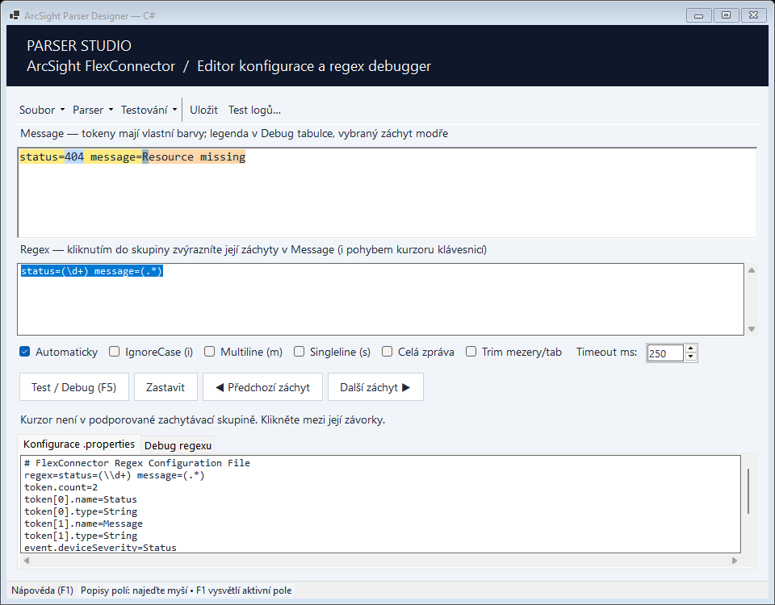
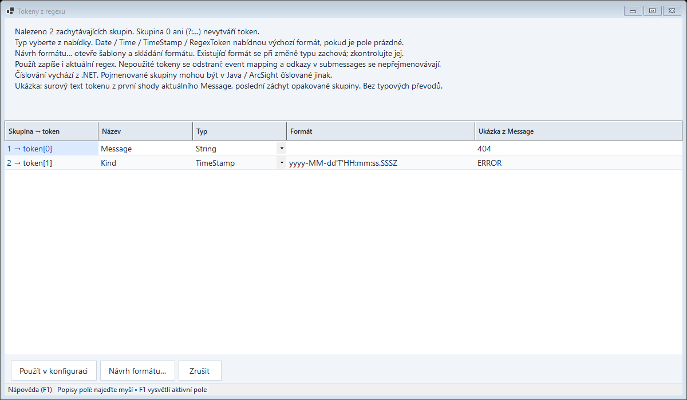

# ArcSight FlexConnector Parser Designer

A Windows desktop workbench for authoring ArcSight FlexConnector regex parsers.
Build a parser from sample logs, inspect capture groups, define tokens and event
mapping, and test submessage variants against an entire log file.

The active application uses **C# / WinForms / .NET 10**. Its interface and built-in
help are Czech; source comments and developer documentation are English.
The publication package contains only the C# solution and its supporting files.



## Features

- Regex preview with capture colors, group-to-message navigation and diagnostics.
- Token generation with captured-text snippets, type selection and a format builder.
- Event mapping editor for tokens, constants and ArcSight expressions.
- Multiple submessages, ordered patterns and default routing.
- Batch log testing with filters, navigation and parser editing.
- Severity rules and extra processor configuration templates.
- Java properties escaping and preservation of unrelated configuration blocks.
- Up to 100 text undo steps, redo and searchable contextual F1 help.
- Compact menus and layouts checked at supported minimum window sizes.

## Requirements

- Windows with **.NET 10 SDK**, including Windows Desktop reference packs, to build.
- **.NET 10 Windows Desktop Runtime** to run the framework-dependent application.
- An interactive Windows desktop session for WinForms UI tests.

There are no external NuGet dependencies. `csharp/NuGet.Config` clears package
sources; required SDK/reference packs must already be installed. The local PDF
guide is a development reference, not a runtime dependency.

## Build and run

In the prepared distribution, start **`app/ArcSight.ParserDesigner.exe`**.
Keep the entire `app/` folder together and install .NET 10 Windows Desktop Runtime.
See [distribution details](docs/DISTRIBUTION.md) and [GitHub publishing](docs/GITHUB.md).

From the repository root:

```powershell
dotnet build csharp/ArcSight.ParserDesigner.slnx -c Release
dotnet run --project csharp/ParserDesigner/ParserDesigner.csproj -c Release --no-build
```

Or open `csharp/ArcSight.ParserDesigner.slnx` in a compatible Visual Studio.
The executable is located at
`csharp/ParserDesigner/bin/Release/net10.0-windows/ArcSight.ParserDesigner.exe`.
Distribute the **entire output directory**, not just the EXE.

## Quick start

1. Use **Soubor → Otevřít parser…** to load an example from `examples/`.
2. Paste a log into **Message** and edit the decoded expression in **Regex**.
3. Press **F5**. Click a capturing group to highlight its captured text.
4. Open **Parser** to configure tokens, submessages, event mapping and severity.
5. Use **Testování → Test souboru logů…** to test multiple sample events.
6. Apply dialog changes, then **Uložit / Ctrl+S** to save the configuration.

Press **F1** in an editor for contextual help. See the complete
[Czech user guide](docs/USER_GUIDE.cs.md) for detailed usage.

The token editor includes a read-only sample of each token captured from the
current Message. Hover over a sample for more text and its original position.
Empty and unmatched captures are distinguished; snippets are not written to the parser.



## Verification

```powershell
./scripts/verify.ps1
```

This builds into `build/verify`, runs the core and WinForms regression executables,
and checks source formatting. Tests return a nonzero exit code on failure.
UI screenshots are written to `build/`. These are executable test programs,
not projects discovered by `dotnet test`.

## Scope and limitations

This is an authoring and preview tool, **not a complete SmartConnector runtime**.
The preview uses .NET regex; ArcSight uses Java regex. Group numbering and some
syntax or Unicode behavior can differ.

The application previews captures, submessage routing and limited severity rules.
It does not execute general ArcSight operations, full event mapping, token type
conversions, format parsing, RegexToken substitution or linked extra processors.
Batch testing treats each physical line as one event; it does not assemble
multiline events. Validate the saved parser in the target connector before use.

## Documentation

- [Architecture and data flow](docs/ARCHITECTURE.md)
- [Core modules and contracts](docs/CORE_REFERENCE.md)
- [UI modules and editing lifecycle](docs/UI_REFERENCE.md)
- [Development, testing and extension recipes](docs/DEVELOPMENT.md)
- [Czech user guide](docs/USER_GUIDE.cs.md)
- [Contribution guidelines](CONTRIBUTING.md)
- [Packaging and GitHub publishing](docs/GITHUB.md)

The module references cover the complete C# solution.

## Repository layout

```text
csharp/
  ParserCore/              Parser/configuration logic without WinForms
  ParserDesigner/          Desktop application and offline help
  ParserCore.Tests/        Core regression executable
  ParserDesigner.UiTests/  WinForms integration/regression executable
examples/                 Sample parser and log pairs
docs/                     Architecture, module references and usage guide
scripts/verify.ps1        Reproducible verification entry point
scripts/package.ps1       Clean source/application packaging
app/                      Compiled application in prepared distributions
```

This project is not presented as an official ArcSight product. A repository
license has not been declared; licensing and redistribution of reference
material should be resolved by the owner before publishing.
