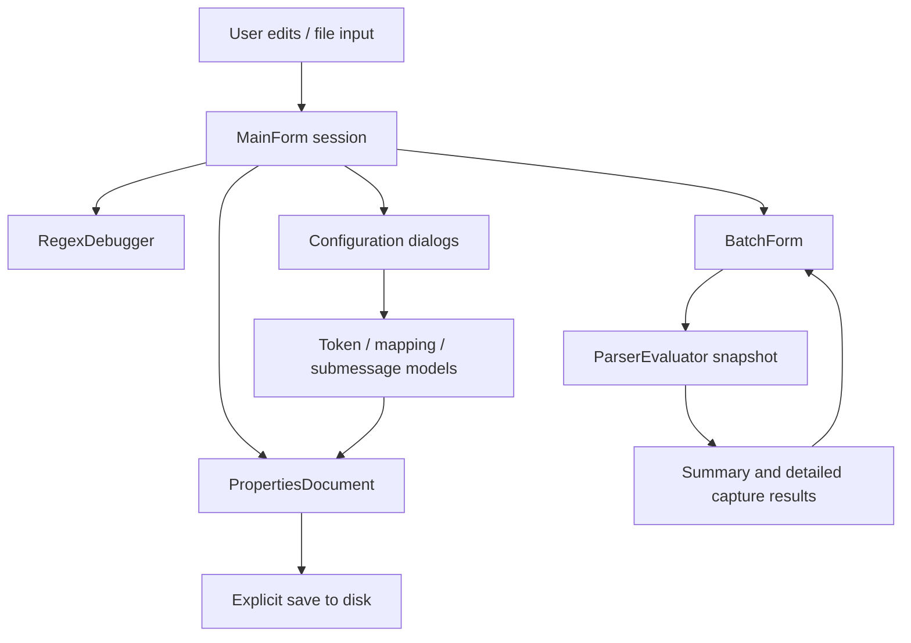

# Architecture

## Project boundaries

Version 2.0 adds `ParserDesigner.CrossPlatform` (Avalonia / .NET 10) as a second
desktop frontend. It shares `ParserCore` and the offline help catalog with the
Windows edition. See [the cross-platform code map](CROSS_PLATFORM.md#code-map)
for its windows, tests, packaging and asynchronous lifecycle. The WinForms-specific
sections below still describe the original frontend.

`ParserCore` targets .NET 10 and has no UI dependency. It parses properties,
compiles regexes, evaluates previews, and builds edited configuration strings.
`ParserDesigner` targets Windows and references `ParserCore`; it owns forms,
user interactions, cancellation, file dialogs and visual state.

Two console executables exercise the core and real WinForms controls. Neither
uses a test framework package. `Directory.Build.props` enables nullable analysis,
implicit usings and warnings-as-errors for all projects. `Program.Main` starts
the application on an STA thread.

## Three representations

1. **Source text:** the complete `.properties` document, including comments and
   unrelated options. This remains the interchange format between dialogs.
2. **Decoded values:** regex, token format and mapping editor values do not
   contain the extra escaping required by Java properties. Encode at the document
   boundary, not in individual controls.
3. **Compiled snapshot:** `ParserEvaluator` validates and compiles a source string
   once. A batch run captures that instance so an edit cannot mix configurations
   within a run.

`PropertiesDocument.Values` is a decoded lookup of the effective final definition
of each key. Mutate through `Set` and `RemoveWhere`, not by editing this dictionary:
the source representation is maintained separately.

## Editing lifecycle

Dialogs receive a source string and create a draft. Applying returns `ResultSource`
or `ResultFormat`; cancelling leaves the owner unchanged. Applying a dialog is not
a disk save. `MainForm.Configuration.cs` owns loading, saving, dirty-state prompts,
regex synchronization and dialog integration.

The working regex can differ from the `regex` property. `regexDirty` tracks this
separately from document `dirty`. Saving or opening a batch test offers to synchronize
the working regex. Mapping and advanced configuration editors operate on the
document's token declarations, not undeclared captures in the working regex.

Batch edits replace `ConfigurationSource`, rerun the loaded log file and are returned
to the main document when the workbench closes. A filtered-out log cannot remain
selected; otherwise its selection is retained across retesting.

## Asynchronous preview

`MainForm.Analysis.cs` invalidates old results immediately, cancels pending work,
and uses a 250 ms debounce timer. Analysis captures text, expression, options and
a revision number before leaving the UI thread. A semaphore serializes expensive
regex work. Results are published only when the revision still matches, the token
is not cancelled and the form is alive.

`BatchForm` separately controls batch cancellation and selected-log detail work.
Batch summaries omit captures to keep memory bounded. Selecting a row evaluates
details from the current immutable snapshot; a detail version prevents stale
selection results from appearing over a newer selection.

Cancellation is cooperative between regex operations. A regex already executing
is bounded by its timeout, not interrupted instantaneously.

## Highlighting and undo

Capture positions use UTF-16 offsets in the original input, including offsets
removed by trimming. Broad captures are painted before narrow nested captures.
`RegexGroupMap` identifies source group regions, while actual captures come from
the .NET engine. Unsupported conditional/balancing syntax disables source mapping
rather than guessing group positions.

RichTextBox formatting must preserve caret and scroll position and must not become
an undo step. `EditHistory` stores text differences, not 100 full documents. Native
window-message transactions coalesce replacement notifications into one edit.
Undo restores text through normal controls so dirty-state and preview events still
run. Structural tree/table edits are outside text history.

## Compatibility boundary

The application does not implement the SmartConnector runtime. Direct event-field
type warnings are advisory; operation return types and converted values are not
evaluated. Do not describe regex success as verification of the final event.
Java/.NET regex differences and the one-line batch model are explicit product
constraints, documented in both README and offline help.

See [core contracts](CORE_REFERENCE.md) and [UI ownership](UI_REFERENCE.md).
