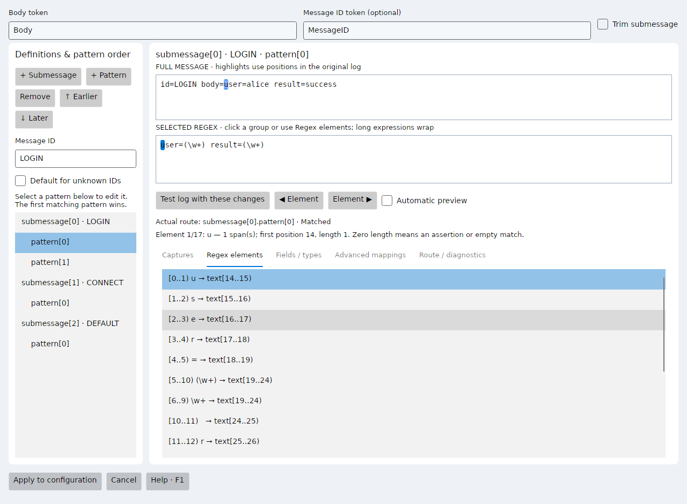

# Offline parser suggestions and element debugging (2.1)

These features belong to the Avalonia cross-platform edition.

## Generate a parser from sample logs

1. Open **Suggest parser…** and paste 2–200 nonempty events, one per line.
2. Select **Generate and validate**. The application uses local structural heuristics; it does not call an AI API or upload samples.
3. Review both the proposed properties and coverage report.
4. Select **Use proposed parser**, then confirm replacement of the working draft. Nothing is written to disk until Save.
5. Test additional, previously unseen logs using **Test log file…**. Refine types/formats, mappings, submessages and severity in their existing editors.

The generator recognizes whitespace-separated fields, key=value fields and quoted values containing spaces. It preserves constant literals, generalizes variable fields, names tokens from keys, and suggests mappings for user, address, port, host, action, message, severity and event ID keys. Unknown fields use six custom-string slots; any overflow is explicitly reported and matched without extraction. Invalid IP/numeric samples are kept as custom strings. Quoting escapes, nested JSON/XML, multiline events and arbitrary delimiters require manual refinement; unsupported samples may be rejected when coverage validation fails.

One structure produces a main regex and tokens. Multiple structures produce a RawMessage token and ordered alternative patterns in a default submessage, with fields, types and formats. Message-ID routing is not inferred. Recognized textual severity labels receive conventional mappings with a review notice; numeric scales are not guessed. Extra processor dependencies and timestamp formats cannot be reliably inferred from examples and must be configured manually. This is a complete testable draft, not a certified production parser.

Limits: 250,000 pasted characters, 8,000 characters per event, 100 whitespace-separated fields per event and 30 structures. Validation is bounded and cancelled when samples change or the dialog closes. Every provided sample must match before a proposal can be applied. Matching samples alone does not prove field semantics or generalization.

## Event mapping snippets

Open **Event mapping…** after entering Message and the working Regex. Each existing mapping row and the draft value show the referenced token's captured text. Values come from the first match; repeated groups use their last capture. Empty captures, missing token captures and no-match errors are distinguished. Hover to see up to 2,000 characters. The visible snippet is capped at 120 characters.

Changing the mapping expression refreshes the snippet. String constants are displayed; other ArcSight expressions are explicitly marked as not evaluated. These are raw main-token previews, not the final event after submessage overrides, conversions or extra processors.

## Regex element navigation

Press F5, open **Regex elements**, then use **Next element / Previous element**, select a list row or click inside the regex while that tab is selected. The application selects the corresponding regex source and highlights matching spans in Message. Elements include individual literals, escapes, character classes, quantified atoms, groups and assertions.

Repeated atoms may highlight multiple spans. Assertions and empty matches have zero-length positions and therefore no colored characters. Skipped alternatives have no capture. Source-order navigation describes the final first match or a partial prefix preview; it is not execution-order stepping or internal backtracking.

### Partial previews (2.3)

When the complete regex fails, the debugger probes supported regex prefixes and may highlight a matching span in orange, marked **PARTIAL**. Open **Regex elements**, click inside the regex, or use the Element arrows to inspect which atoms captured text. For example, `abcZ` against `abcX` highlights `abc`; the final `Z` has no capture. The status reports zero-based UTF-16 text positions and a boundary in the regex source. The ordinary capture table still requires a complete match.

This is a prefix hypothesis, not the engine's first failure or backtracking trace. Prefixes are ranked by captured element count, then earlier text position and longer matched text. The search has a two-second budget and can return a limited result. It never changes actual parser success, token extraction or submessage routing.

With **Entire message**, a prefix starts at the beginning of the tested text; without it, a prefix can be found later, subject to explicit anchors. Trim offsets are preserved; submessage highlights use positions relative to the extracted body token. Unquantified ordinary/noncapturing groups can be explored internally. Quantifiers remain intact: `\d{4}` does not become a two-digit match. Unfinished repeated groups and lookarounds are not expanded. Unsupported syntax and cases without a consuming prefix are explained in Diagnostics. Submessage previews require the main regex to have captured the configured body token.

The bounded instrumentation supports ordinary groups, noncapturing groups, atomic groups, lookarounds, classes, escapes, quantifiers and alternatives. Backreferences, numeric escapes, named/balancing groups, conditionals, inline flags/comments and nested/subtracted character classes are explicitly rejected in element preview; normal capture debugging remains available. Limits: 8,000 regex characters, 512 elements, 64 nested groups and 5,000 displayed spans. Diagnostics explains unsupported syntax and timeouts.

## Code map

- ParserCore/ParserSuggester.cs: structural clustering, regex/token/mapping proposal and coverage validation.
- ParserCore/RegexElementDebugger.cs: conservative regex instrumentation and source-to-message spans.
- ParserDesigner.CrossPlatform/SuggestParserDialog.cs: isolated proposal, cancellation, validation and explicit apply.
- ParserDesigner.CrossPlatform/MappingDialog.cs: raw token and constant snippets.
- ParserDesigner.CrossPlatform/MainWindow.cs: element navigation and proposal integration.

All processing uses the existing local .NET engine. Validate the final configuration in ArcSight's Java-based connector.

## Submessage workbench (2.2)

The cross-platform Avalonia window uses the same implementation on Windows, Linux and macOS. Windows and Ubuntu/WSLg are runtime-tested; macOS is not tested in this environment.

The left pane contains definitions, ordered patterns and the selected message ID/default setting. The right pane keeps the extracted value of submessage.token and selected regex visible. The read-only token view shows the full raw value; the Original log tab holds the editable full event. Changing the original log or body-token dropdown automatically re-extracts it; F5 also refreshes the preview. If extraction fails, the view clears and reports the missing token. Captures, Regex elements, Fields / types, Mappings and Diagnostics have separate tabs. Long regexes wrap and the inputs retain their existing 100-step undo support.

Automatic preview is enabled by default, as in the main window, and refreshes after a 350 ms typing pause or pattern selection. Turn it off for manual testing with F5 or Test preview (F5). Edits and node switches cancel stale work and clear previous highlights while retaining the extracted body; invalid regexes are reported inside the window. Applying still validates and exports the entire submessage configuration.

Application limits are 1,000 submessage definitions (indices 0–999), 1,000 patterns per definition (indices 0–999), and 5,000 patterns in total. These are local preview limits, not a claim about the ArcSight engine's maximum.

Enable **Default for unknown IDs** to omit a definition's `messageid` property. Its patterns are tried in order until the first match for an ID without its own definition, or when no ID token is configured. If no pattern matches, testing reports a submessage mismatch. A known ID whose patterns fail does not switch to this default. Leaving an explicit `messageid=` property empty is different from removing it. This behavior was already supported; it is now covered by explicit ordered-alternative regressions.

Source checked on 2026-10-20: [OpenText/Micro Focus, Using Sub-Messages for Multiple File Formats](https://www.microfocus.com/documentation/arcsight/arcsight-smartconnectors-8.4/flexconn_devguide/Content/convertFlex/Sub_Messages.htm), sections on ordered patterns and Default Sub-message.

The persistent Actual route label identifies the winning definition/pattern. Independently, the selected pattern is evaluated against the complete captured body token, even if routing selected another pattern or ID. A notice explicitly says when the selected pattern was NOT used by routing. This lets you tune later alternatives without reordering or changing production routing.

Click a capture row or a group in the regex to highlight its token-relative span. Open Regex elements or use the Element arrows to step through literals, classes, quantifiers, groups and assertions, selecting the regex source and highlighting corresponding message spans. Trim offsets within the raw token are preserved. The core and batch results still retain original-log positions. Long body values are taken from the original input rather than truncated display snippets. Zero-length matches show positions; skipped alternatives have no final capture. The same supported-syntax and partial-preview limitations described above apply.

Implementation: ParserCore/SubmessageDebugger.cs coordinates route evaluation, selected-pattern capture analysis and element instrumentation. ParserDesigner.CrossPlatform/SubmessagesDialog.cs owns selection, debounce/cancellation, tabs and highlight navigation. No network service or new external dependency is used.

## Property placement (2.2.1)

New keys are inserted beside their existing category and indexed siblings, rather than appended to the end of the file. This applies to tokens, submessages and nested patterns, event mappings (including conditional descendants), severity rules and extra processors. Numeric indices sort naturally: 2 precedes 10. New token formats stay beside their token; new submessage pattern fields stay beside their pattern.

When a category has no existing keys, insertion uses this default sequence: main regex and trim.message, tokens, submessages and trim.submessage, event mappings, severity, extra processors. Existing keys are not globally reordered. A file that already has scattered sections is not automatically reformatted or consolidated. Unknown property families retain their existing position; newly added unknown keys are appended.

Unchanged properties retain their original raw formatting, separators, escaping and continuations. Existing comments remain in place; preceding comment blocks are kept with following sections when inserting before them, except that the initial file banner is retained at the start. New/changed lines use the file's first detected newline style. Custom fields and unrelated source blocks are preserved.

Submessage updates retain existing indexed keys in place and remove only obsolete keys. Extra processor edits merge properties in place, retaining custom options and importing added comments without duplicating comments already present. Original comments are conservatively retained rather than interpreted as deletable editor metadata. Comments associated with reordered indices remain at their existing source positions; the application cannot infer their intended meaning.

This is a shared ParserCore change used by both C# frontends. It changes source placement, not submessage routing or expression semantics. The order of indexed alternatives still comes from their indices.

Implementation: PropertyLayout.cs classifies known categories and compares hierarchical key paths; PropertiesDocument.Set handles insertion and unchanged-source preservation; MergeFrom merges processor drafts and comments. Regression tests cover every category, nested numeric indices, line endings, continuations, custom properties and repeated application.

## Token-based submessage input (2.3.1)

The main regex first extracts named tokens. submessage.token names the token containing the text parsed by every selected submessage pattern; submessage.messageid.token independently names the routing ID token. The workbench now displays that body as its main input and automatically extracts it when opened. Changing the configured token and retesting updates the body. An empty captured token is distinct from a missing capture. No fallback to the full event is performed.

Verified against the supplied FlexConn_DevGuide.pdf, page 139 (Sub-Messages), and the [official online guide](https://www.microfocus.com/documentation/arcsight/arcsight-smartconnectors-8.3/pdfdoc/FlexConn_DevGuide/FlexConn_DevGuide.pdf).

## Reliable body previews and token selectors (2.3.2)

Body token and Message ID token use dropdowns populated from declared main tokens. The empty ID entry means no routing token. An existing undeclared value is retained for diagnosis instead of silently replaced. Selecting a body token automatically refreshes its content.

Body extraction uses only the main parser and is independent of submessage validation. Invalid or unfinished submessage patterns no longer hide a valid body. Editing patterns or switching definitions preserves the extracted body while clearing stale highlights. Saving still validates the entire configuration. If extraction cannot succeed, the input label explains missing declarations, unmatched main regex, skipped optional captures or configuration errors. An empty captured value is reported as zero characters.
